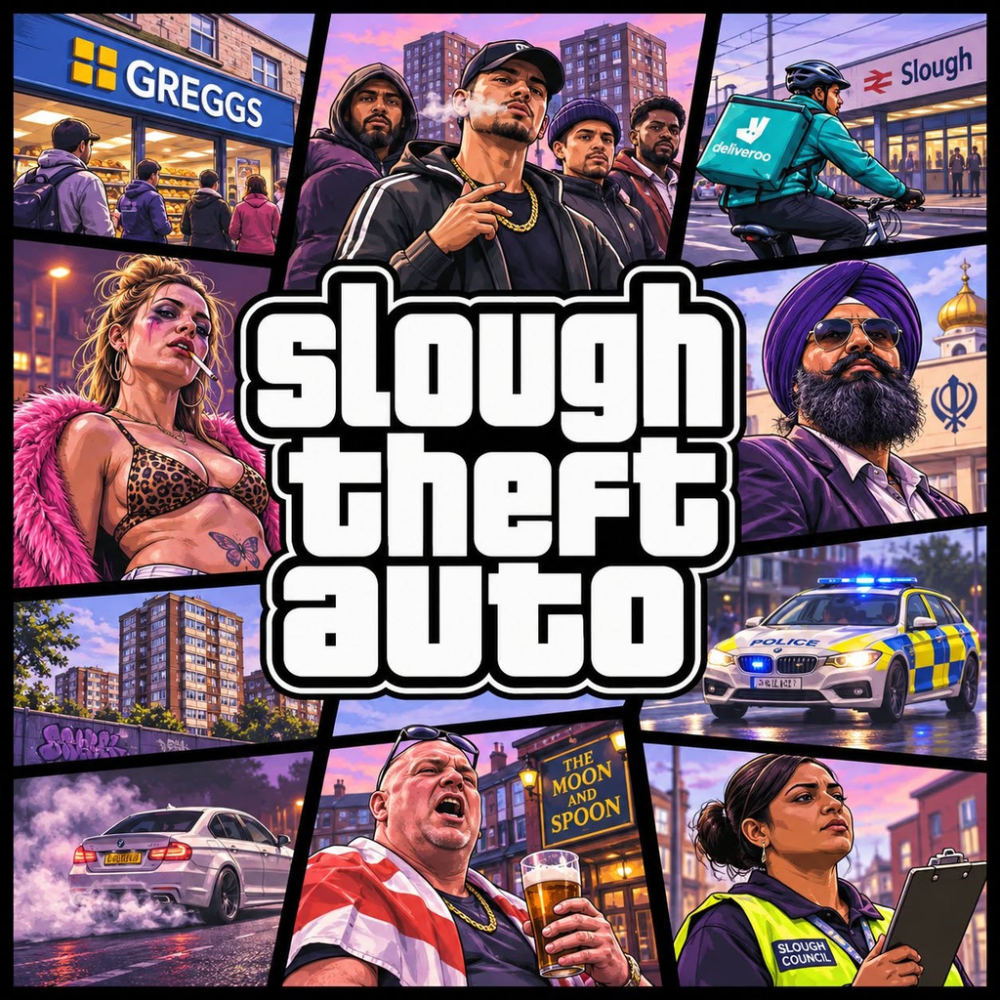

  

# SLOUGH THEFT AUTO

*A highly original game set in Slough, UK.*

You steal cars. You do crimes. You go up a wanted level. Nobody has ever made a game like this, and our lawyer agrees, mainly because we can't afford one.

## What is it?

An open-world crime game set in Slough, a town best known for The Office, a Mars factory, and being where the train stops before Reading.

The map is built from real street data and Environment Agency LiDAR, accurate to within a few centimetres. You can find your own house. You can steal your own car. You can get run over outside your own Greggs.

## Features

- **Greggs health system.** Sausage roll heals you. Steak bake gives you armour. Vegan sausage roll heals you, then makes you talk about it.
- **Multilingual pedestrians.** Get judged in Polish, Arabic and Hindi. Just like the real High Street.
- **Phone boxes that ring.** Pick one up for a mission. Players under 25 will need the tutorial.
- **Dogs.** Protect the dogs. If a dog dies, the game doesn't end, but you'll know what you did.
- **Hidden packages.** We would tell you whats in them, but we can't find them.
- **Mobility scooter chases** down Burnham High Street. Top speed 4 mph. Still faster than the Bath Road at half five.

## Story

A lad gets out of Feltham. He's got no money, no mum, and a dealer who owes him an apology and gives him an invoice instead.

Things escalate. A confectionery factory is involved. We can't say which one, which is rich, coming from an organisation called Copyright Infringement Madness.

## System requirements

- x64 Windows PC or Apple Silcon Mac, a graphics card, and the will to live
- 8 GB RAM
- Prior experience of the M4 between junctions 5 and 7

## Installation

Clone it. Build it. Double-click it. If it crashes, that's not a bug, that's Slough.

## Legal

Hosted by Copyright Infringement Madness, a name chosen for its originality, calming, legally reassuring tone and initials.

Slough Theft Auto is not affiliated with, endorsed by, or known to any games company, bakery chain, chocolate manufacturer, or Slough Borough Council, who we assume would like a word.

All crimes are fictional. Please don't nick cars in real life. Get the bus like everyone else, and suffer.

## Licence

'Low dat.

## Other

Special thanks to Rockstar Games for no reason whatsoever.
